<p align="center">
  <a href="https://djason-chery.dev" title="Ouvrir djason-chery.dev">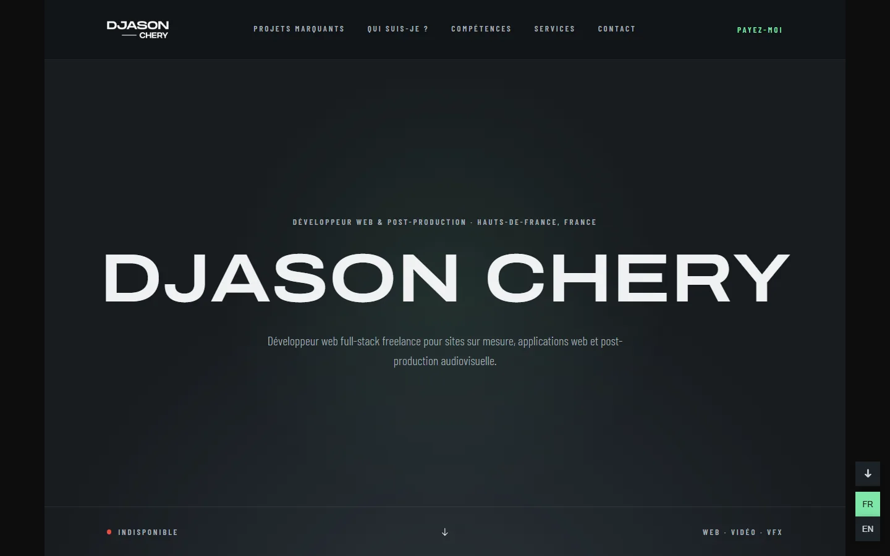</a>
</p>

<p align="center">
  <a href="https://djason-chery.dev" title="Ouvrir le site en ligne"></a>
  
  
  
  
  
  
  <a href="LICENSE" title="Lire la licence"></a>
</p>

<p align="center">
  <a href="https://djason-chery.dev" title="Ouvrir le site en ligne"><b>VOIR LE SITE</b></a> &nbsp;&nbsp;·&nbsp;&nbsp;
  <a href="#ce-que-fait-le-site" title="Aller aux fonctionnalités"><b>FONCTIONNALITÉS</b></a> &nbsp;&nbsp;·&nbsp;&nbsp;
  <a href="docs/fr/README.md" title="Lire la documentation en français"><b>DOCUMENTATION</b></a> &nbsp;&nbsp;·&nbsp;&nbsp;
  <a href="README.md" title="Read this page in English"><b>ENGLISH</b></a>
</p>

# djason-chery.dev

[English](README.md "Read this page in English") · **Français**

Le site de [Djason CHERY](https://djason-chery.dev "Site de Djason CHERY"), **développeur web full-stack** freelance et
spécialiste de la **post-production audiovisuelle** (montage, compositing, effets visuels), dans les Hauts-de-France.

Un seul projet **Nuxt 4** contient le site et son API (Nitro), rangé comme un projet
[DC Scaffold](https://github.com/Djason16/dc-scaffold "DC Scaffold sur GitHub"). En plus des pages publiques (projets,
compétences, services, prise de rendez-vous, paiement en ligne), un espace d'administration privé gère les clients, les
missions, les projets, les compétences et les disponibilités, fait les devis, factures et contrats en PDF et encaisse
les paiements avec Stripe.

**Site en ligne : [djason-chery.dev](https://djason-chery.dev "Ouvrir le site en ligne")**

## Ce que fait le site

| Partie | Fonctionnalités |
| --- | --- |
| Accueil | Bandeau, projets marquants (photo au survol, détail dans une fenêtre), « Qui suis-je ? », compétences par domaine, services, contact avec les horaires ; une animation d'arrivée par section |
| Langues | Français et anglais sur tout le site ; le français tapé dans l'admin remplit l'anglais (MyMemory, gratuit, sans clé) |
| Prise de rendez-vous | Page `/book/` comme Calendly : types de rendez-vous (téléphone, visio, en personne), créneaux libres tirés de l'agenda moins les indisponibilités, affichés dans le fuseau horaire du visiteur, confirmation par e-mail avec `.ics` et lien d'annulation |
| Salon visio | Salle maison en tête-à-tête pour les rendez-vous visio (`/room/<jeton>/`) et salon personnel `/room/` où l'on frappe avant d'entrer : WebRTC entre les deux navigateurs, flou ou image d'arrière-plan (MediaPipe hébergé par le site), discussion, réactions, choix caméra / micro / haut-parleur, image dans l'image |
| Paiement | Page `/pay-me/` : paiement libre ou d'un document par Stripe Checkout, plans de paiement et abonnements, pages de résultat |
| Administration | Connexion par e-mail et code à usage unique, mot de passe oublié par lien d'une heure, outils regroupés par tâche : clients, missions, projets, compétences, calendrier, réservations, salon visio, textes du site et des documents, variables d'environnement |
| Documents | Devis, factures et contrats enregistrés et numérotés au format choisi, paiements, taux d'intérêt légaux, relances automatiques, PDF avec du vrai texte aux couleurs du site |
| Mentions et règles | Mentions légales, confidentialité, conditions, remboursement, rétractation en ligne, bandeau cookies rendu par le serveur |
| API | Routes REST automatiques à partir des contrôleurs, même format JSON partout, données rafraîchies en direct dans l'admin (versions des tables) |

<table>
  <tr>
    <th width="50%">Projets marquants</th>
    <th width="50%">Détail d'un projet</th>
  </tr>
  <tr>
    <td width="50%">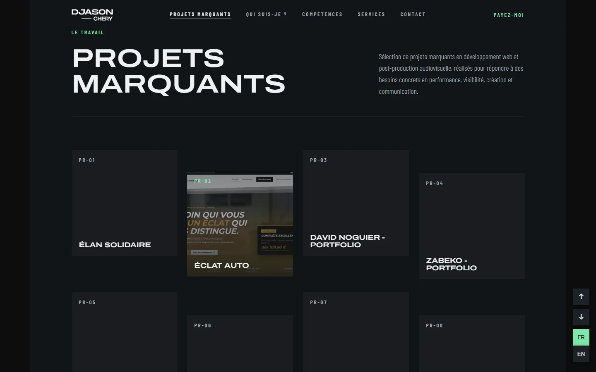</td>
    <td width="50%">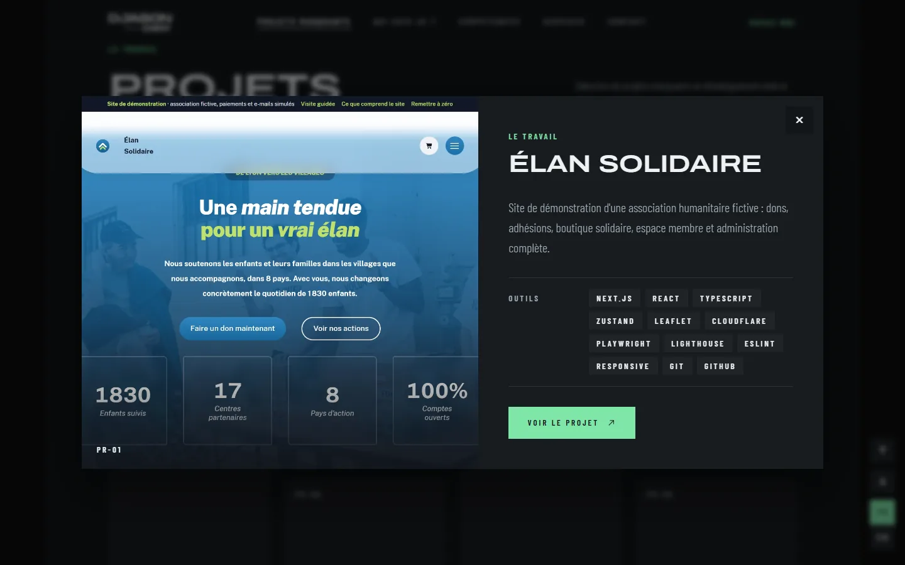</td>
  </tr>
  <tr>
    <th width="50%">Compétences</th>
    <th width="50%">Services</th>
  </tr>
  <tr>
    <td width="50%">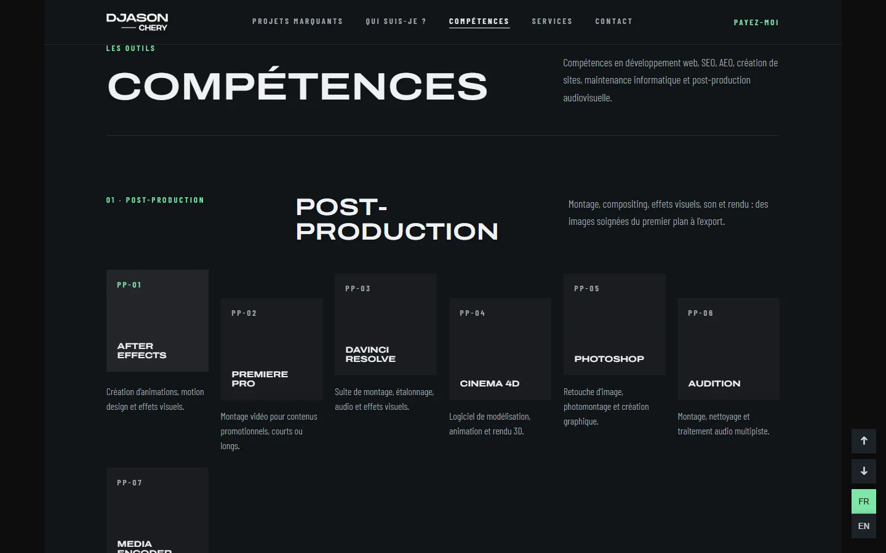</td>
    <td width="50%">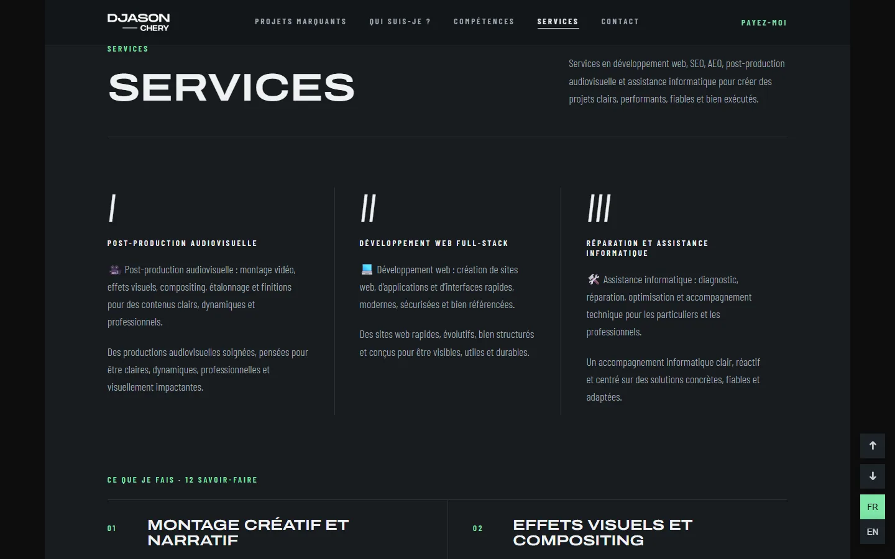</td>
  </tr>
  <tr>
    <th width="50%">Réserver un créneau</th>
    <th width="50%">Payez-moi</th>
  </tr>
  <tr>
    <td width="50%">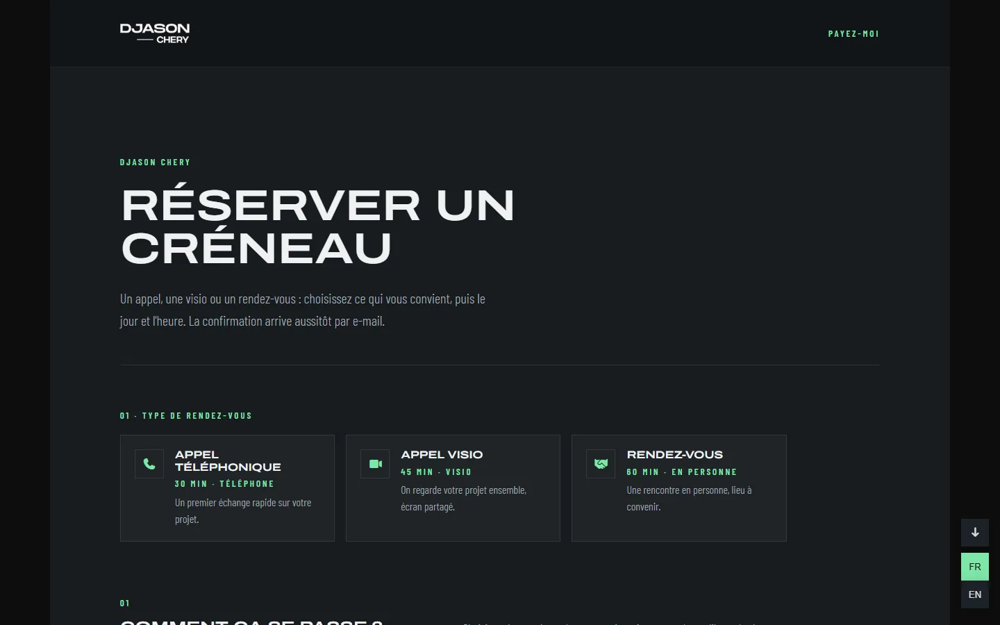</td>
    <td width="50%">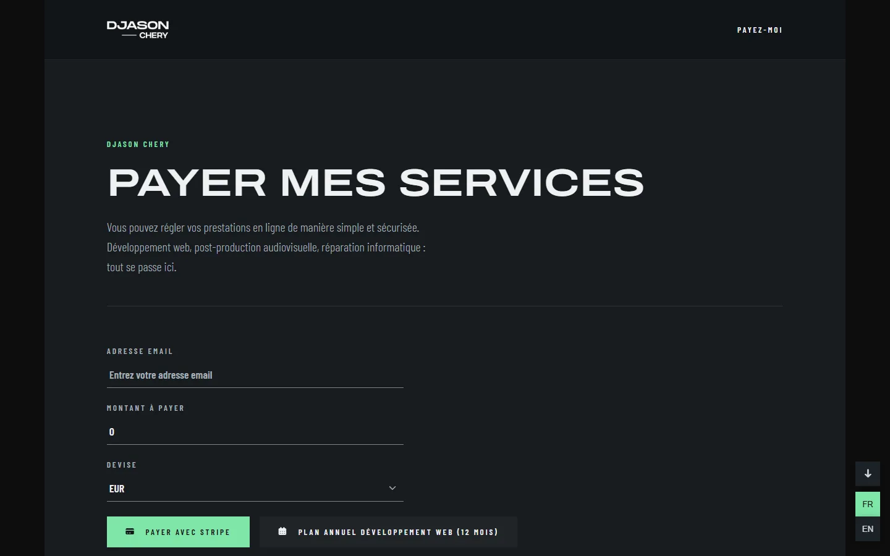</td>
  </tr>
  <tr>
    <th width="50%">Mentions légales</th>
    <th width="50%">English</th>
  </tr>
  <tr>
    <td width="50%">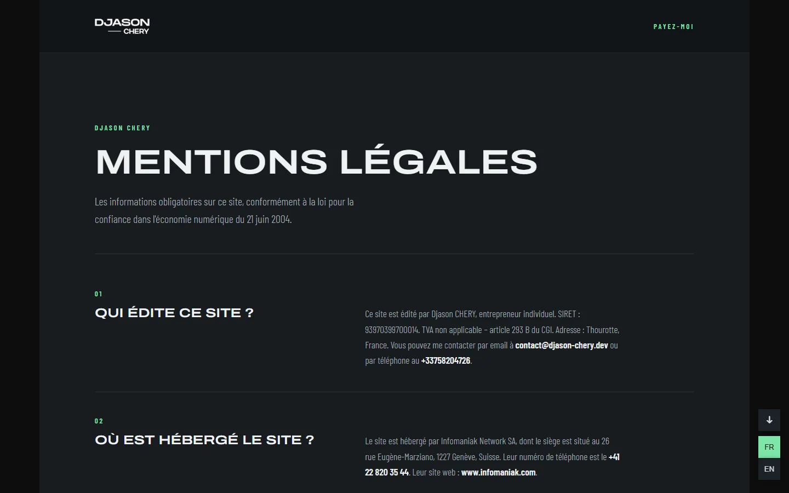</td>
    <td width="50%">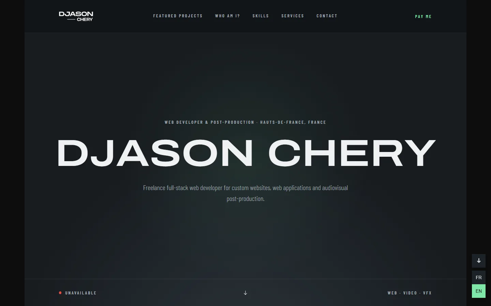</td>
  </tr>
</table>

<table>
  <tr>
    <th width="50%">Téléphone</th>
    <th width="50%">Menu</th>
  </tr>
  <tr>
    <td width="50%" align="center">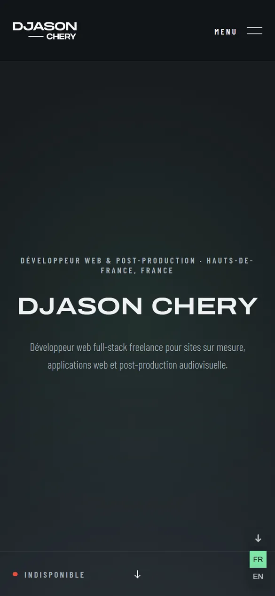</td>
    <td width="50%" align="center">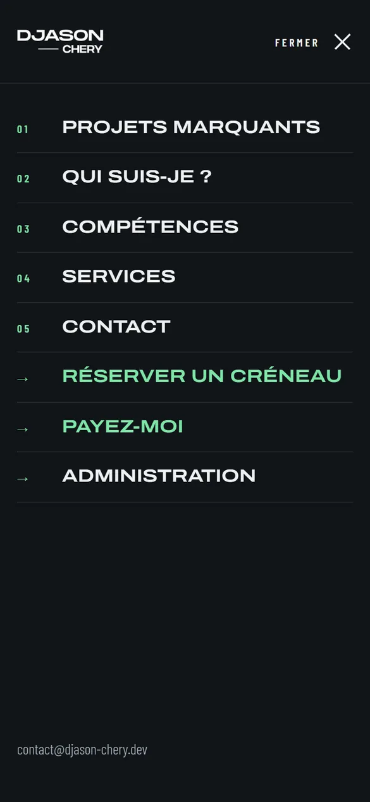</td>
  </tr>
</table>

## Stack

- [Nuxt 4](https://nuxt.com "Nuxt") (Vue 3.5, rendu par le serveur) et son serveur **Nitro** pour l'API, tout en
  **TypeScript** (`npm run typecheck` à zéro erreur)
- [Pinia](https://pinia.vuejs.org "Pinia") pour les stores (réglages du site, textes, listes de l'admin, préférences)
- **MySQL** (`mysql2`), Docker et phpMyAdmin en local, base MySQL d'Infomaniak en ligne ; tables `dc_*` créées au
  démarrage
- [Stripe](https://stripe.com "Stripe") (Checkout, abonnements, webhook), [Nodemailer](https://nodemailer.com "Nodemailer")
  pour les e-mails, [jsPDF](https://github.com/parallax/jsPDF "jsPDF") pour les PDF
- WebRTC pour le salon visio, [MediaPipe](https://ai.google.dev/edge/mediapipe "MediaPipe") pour les arrière-plans,
  chargé seulement au choix d'un effet
- CSS simple avec variables, polices Archivo et Barlow Condensed hébergées avec le site, Font Awesome 7 réduit aux
  icônes utilisées (`scripts/icons.mjs`)
- `@nuxtjs/sitemap` et `@nuxtjs/robots`, réglés comme le modèle de DC Scaffold

## Lancer le site

Il faut **Node.js 22.16+** (24 LTS conseillé) et **Docker Desktop** (base MySQL locale).

**Windows :** `start.bat` puis `I` (installation, la première fois) et `D`. Le site s'ouvre sur http://localhost:3000,
phpMyAdmin sur http://localhost:8081.

**macOS / Linux :**

```bash
git clone https://github.com/Djason16/dc-portfolio.git
cd dc-portfolio/frontend
cp .env.example .env   # puis remplir les valeurs
docker compose --project-directory .. --env-file .env up -d   # MySQL + phpMyAdmin
npm install
npm run dev            # http://localhost:3000, API sur /api
```

`frontend/.env.example` liste chaque variable (base, compte admin, SMTP, Stripe, banque, traduction, relais visio).
Pour tester sans envoyer d'e-mail, `MAIL_LOG_ONLY=true` les écrit dans le journal du serveur. Détails :
[docs/fr/02-configuration.md](docs/fr/02-configuration.md "Configuration").

## Scripts et contrôles

À lancer dans `frontend/`.

| Commande | Rôle |
| --- | --- |
| `npm run dev` | Site de développement sur http://localhost:3000 (réduit Font Awesome et copie MediaPipe avant) |
| `npm run typecheck` | TypeScript (`nuxt typecheck`) : zéro erreur |
| `npm run build` | Version de production dans `.output/`, lit `.env.production` |
| `npm run build:qualif` | Version de qualification, lit `.env.preprod` (`start.bat` puis `Q`) |
| `npm run start` | Lance la version construite (`node .output/server/index.mjs`) |
| `npm run db:backup` / `db:restore` | Sauvegarde et restauration de la base locale et de ses images envoyées (`start.bat` puis `K` / `O` : développement local seulement ; la base de production est sauvegardée chaque dimanche par DC Sentinel, voir [Mise en ligne](docs/fr/08-mise-en-ligne.md "Mise en ligne")) |

## Dossiers

```text
frontend/
├── pages/              un fichier par page : il pose son SEO et affiche sa vue
├── components/
│   ├── layout/         AppShell (chargement, en-tête, pied de page, bandeau cookies, langue), Header, Footer
│   ├── ui/             briques réutilisables : Button, Form, Image, Modal, Table, SectionLayout, Loader, Toast...
│   └── views/          le contenu de chaque page (Index, Book, Room, PayMe, Admin, Documents, Legal...)
├── composables/        useAuth, useLang, useSeo, useRoomCall, useBookingAdmin, useProjects...
├── stores/             stores Pinia et leurs actions dans stores/actions/
├── plugins/            langues (translations/ fr et en), données en direct, animations d'arrivée
├── utils/              api.ts (client de l'API), billing.ts, pdf.ts, scroll.ts, room/ (salon visio)...
├── data/               projets, services et compétences de départ
├── server/
│   ├── api/            [...path].ts : routeur de tous les contrôleurs
│   ├── controllers/    un *Controller.ts par ressource = les routes de l'API
│   ├── utils/          base de DC Scaffold : Controller, RequestHelper, ResponseHelper, DatabaseHelper...
│   ├── helpers/        helpers du site : DatabaseSchema, MailHelper, StripeHelper, BookingHelper, RoomHelper...
│   ├── middleware/     redirection www, en-têtes de sécurité
│   ├── plugins/        création des tables, qualif, compression des pages
│   └── templates/      e-mails et pages de résultat Stripe
├── scripts/            icons.mjs, mediapipe.mjs, qualif.mjs, db-backup.mjs, db-restore.mjs
└── public/             polices, images, favicon, modèle MediaPipe
mysql/                  image Docker de la base locale et init/example.sql (tables sans donnée personnelle)
scripts/                outils de start.bat (sauvegarde, restauration, qualif)
docs/                   documentation (fr, en) et captures
```

Plus de détails : [docs/fr/03-architecture.md](docs/fr/03-architecture.md "Architecture").

## Règles du site

- **TypeScript partout** : chaque fichier en `.ts`, chaque composant en `<script setup lang="ts">`.
- **Pages fines** : `pages/*.vue` affiche sa vue de `components/views/` et appelle `useSeo`.
- **Aucun texte écrit en dur** : tout passe par les traductions (français et anglais), certains textes se changent
  depuis l'admin.
- **300 lignes au plus par fichier**, commentaires courts en anglais.
- **Survol et appui** seulement à la souris (`@media (hover: hover) and (pointer: fine)`) ; le lien de la page en
  cours porte `aria-current="page"`, qui donne seul le style actif.
- **Un seul écran de chargement** léger, à l'ouverture et à chaque changement de page.
- **Accessibilité** : jusqu'à 320 px de large et de haut, clavier partout, focus visible menthe, contrastes AA, chaque
  lien a un `title`, chaque image un `alt` et un `title`.
- **Sécurité** : en-têtes de sécurité sur chaque réponse, limites d'essais (connexion, contact, réservation), fichiers
  envoyés vérifiés par leur contenu, jetons stockés hachés, textes trop longs refusés. Détails :
  [docs/fr/07-securite.md](docs/fr/07-securite.md "Sécurité").

## Mettre en ligne

Le site et l'API sont une seule application Node.js, hébergée chez **Infomaniak** (HTTPS inclus) :
`npm run build`, puis envoyer `.output/`, `package.json`, `package-lock.json` et `.env.production` ; commande de
démarrage `npm run start`, port `3000`. Au premier démarrage, le site crée les tables manquantes et le compte admin.
Étapes complètes : [docs/fr/08-mise-en-ligne.md](docs/fr/08-mise-en-ligne.md "Mise en ligne").

## Documentation

| Sujet | Français | English |
| --- | --- | --- |
| Démarrer | [01-demarrer.md](docs/fr/01-demarrer.md "Démarrer") | [01-getting-started.md](docs/en/01-getting-started.md "Getting started (English)") |
| Configuration | [02-configuration.md](docs/fr/02-configuration.md "Configuration") | [02-configuration.md](docs/en/02-configuration.md "Configuration (English)") |
| Architecture | [03-architecture.md](docs/fr/03-architecture.md "Architecture") | [03-architecture.md](docs/en/03-architecture.md "Architecture (English)") |
| Le site | [04-le-site.md](docs/fr/04-le-site.md "Le site") | [04-site.md](docs/en/04-site.md "The site (English)") |
| L'API | [05-l-api.md](docs/fr/05-l-api.md "L'API") | [05-api.md](docs/en/05-api.md "The API (English)") |
| Admin et documents | [06-documents-admin.md](docs/fr/06-documents-admin.md "L'admin et les documents") | [06-admin-documents.md](docs/en/06-admin-documents.md "Admin and documents (English)") |
| Sécurité | [07-securite.md](docs/fr/07-securite.md "Sécurité") | [07-security.md](docs/en/07-security.md "Security (English)") |
| Mise en ligne | [08-mise-en-ligne.md](docs/fr/08-mise-en-ligne.md "Mise en ligne") | [08-deployment.md](docs/en/08-deployment.md "Deployment (English)") |
| Dépannage | [09-depannage.md](docs/fr/09-depannage.md "Dépannage") | [09-troubleshooting.md](docs/en/09-troubleshooting.md "Troubleshooting (English)") |

## Contact

<p>
  <a href="https://djason-chery.dev" title="Site de Djason CHERY"></a>
  <a href="mailto:contact@djason-chery.dev" title="Écrire à contact@djason-chery.dev"></a>
  <a href="https://www.linkedin.com/in/djason-chery-3b87702b4" title="Profil LinkedIn"></a>
  <a href="https://www.malt.fr/profile/djasonchery" title="Profil Malt"></a>
  <a href="https://wa.me/33758204726" title="Écrire sur WhatsApp"></a>
  <a href="https://www.instagram.com/djasonchery" title="Profil Instagram"></a>
</p>

## Licence

Code visible pour être lu et évalué, **tous droits réservés** : aucune réutilisation sans accord écrit, voir
[LICENSE](LICENSE "Licence") (licence d'utilisation sur demande : [djason-chery.dev](https://djason-chery.dev "Site de Djason CHERY")).
Les versions publiées avant le 22 novembre 2026 étaient sous licence MIT. Le modèle et le moteur MediaPipe des
arrière-plans du salon visio (`frontend/public/mediapipe/`, `@mediapipe/tasks-vision`) sont sous Apache 2.0, par Google.

## Crédits

- Polices : **Archivo** et **Barlow Condensed** (SIL Open Font License 1.1), par `@fontsource`.
- Icônes : **Font Awesome Free 7** (icônes CC BY 4.0, police SIL OFL 1.1, code MIT).
- Arrière-plans du salon visio : **MediaPipe** Image Segmenter et modèle `selfie_segmenter` (Apache 2.0, Google).
- Traduction automatique de l'admin : **MyMemory**.
- Conception et développement : [Djason CHERY](https://djason-chery.dev "Site de Djason CHERY"), avec
  [DC Scaffold](https://github.com/Djason16/dc-scaffold "DC Scaffold sur GitHub").
