<p align="center">
  <a href="https://djason-chery.dev" title="Open djason-chery.dev">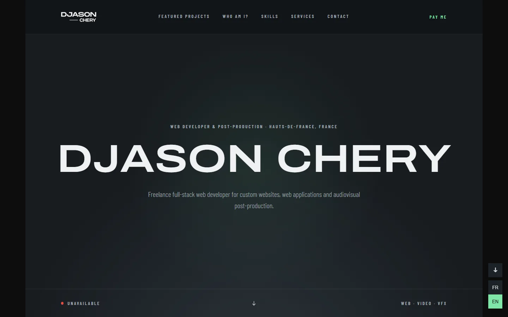</a>
</p>

<p align="center">
  <a href="https://djason-chery.dev" title="Open the live site"></a>
  
  
  
  
  
  
  <a href="LICENSE" title="Read the license"></a>
</p>

<p align="center">
  <a href="https://djason-chery.dev" title="Open the live site"><b>LIVE SITE</b></a> &nbsp;&nbsp;·&nbsp;&nbsp;
  <a href="#what-the-site-does" title="Go to the features"><b>FEATURES</b></a> &nbsp;&nbsp;·&nbsp;&nbsp;
  <a href="docs/en/README.md" title="Read the documentation in English"><b>DOCUMENTATION</b></a> &nbsp;&nbsp;·&nbsp;&nbsp;
  <a href="README.fr.md" title="Lire cette page en français"><b>FRANÇAIS</b></a>
</p>

# djason-chery.dev

**English** · [Français](README.fr.md "Lire cette page en français")

The website of [Djason CHERY](https://djason-chery.dev "Djason CHERY's website"), freelance **full-stack web
developer** and **audiovisual post-production** specialist (editing, compositing, visual effects), based in
Hauts-de-France (France).

One **Nuxt 4** project holds both the site and its API (Nitro), organized like a
[DC Scaffold](https://tools.djason-chery.dev/en/scaffold/ "Discover DC Scaffold") project. Besides the public pages
(projects, skills, services, appointment booking, online payment), a private admin space manages clients, missions,
projects, skills and availability, makes quotes, invoices and contracts as PDF, and takes payments with Stripe.

**Live site: [djason-chery.dev](https://djason-chery.dev "Open the live site")**

## What the site does

| Part | Features |
| --- | --- |
| Home | Hero, featured projects (photo on hover, details in a modal), « Who am I? », skills by field, services, contact with opening hours; one reveal animation per section |
| Languages | French and English on the whole site; the French typed in the admin fills the English (MyMemory, free, no key) |
| Booking | `/book/` page like Calendly: kinds of appointment (phone, video call, in person), free slots from the agenda minus holidays, shown in the visitor's time zone, e-mail confirmation with an `.ics` file and a cancel link |
| Video room | In-house 1-to-1 room for video appointments (`/room/<token>/`) and a personal room `/room/` where visitors knock before coming in: WebRTC between the two browsers, background blur or image (self-hosted MediaPipe), chat, reactions, camera / mic / speaker choice, picture-in-picture |
| Payment | `/pay-me/` page: free amount or payment of a document with Stripe Checkout, payment plans and subscriptions, result pages |
| Admin | E-mail + one-time code login, password reset by a one-hour link, tools grouped by task: clients, missions, projects, skills, calendar, bookings, video room, texts of the site and of the documents, environment variables |
| Documents | Quotes, invoices and contracts stored and numbered in your own format, payments, legal interest rates, automatic reminders, PDF with real text in the colors of the site |
| Legal | Legal notice, privacy, terms, refund policy, online withdrawal, cookie banner rendered by the server |
| API | Automatic REST routes from the controllers, same JSON format everywhere, admin data refreshed live (table versions) |

<table>
  <tr>
    <th width="50%">Featured projects</th>
    <th width="50%">Project details</th>
  </tr>
  <tr>
    <td width="50%">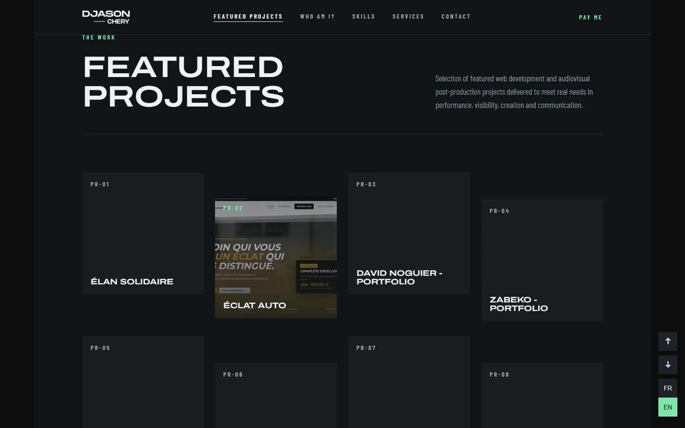</td>
    <td width="50%">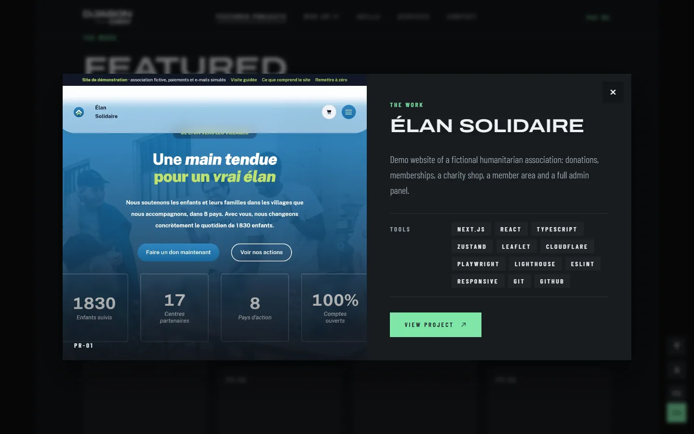</td>
  </tr>
  <tr>
    <th width="50%">Skills</th>
    <th width="50%">Services</th>
  </tr>
  <tr>
    <td width="50%">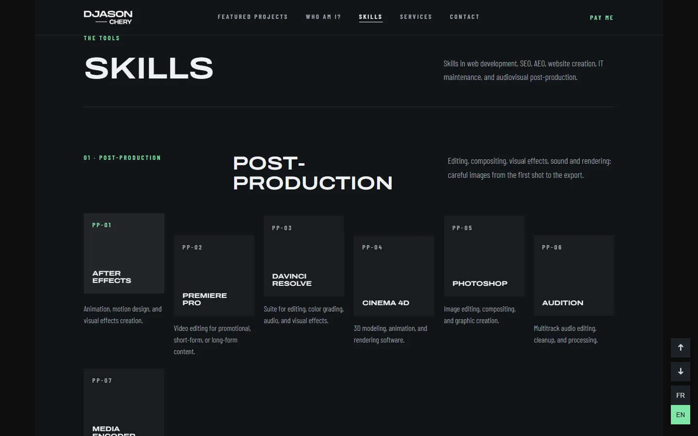</td>
    <td width="50%">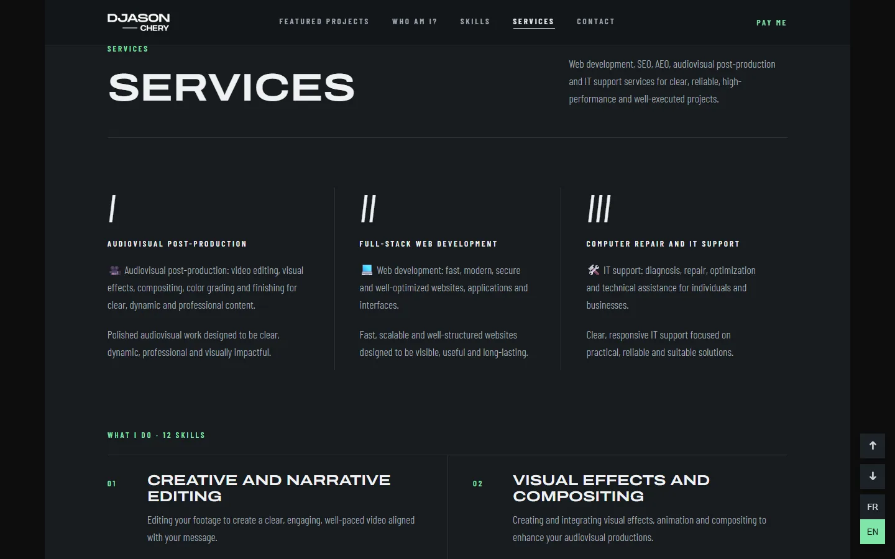</td>
  </tr>
  <tr>
    <th width="50%">Book a slot</th>
    <th width="50%">Pay me</th>
  </tr>
  <tr>
    <td width="50%">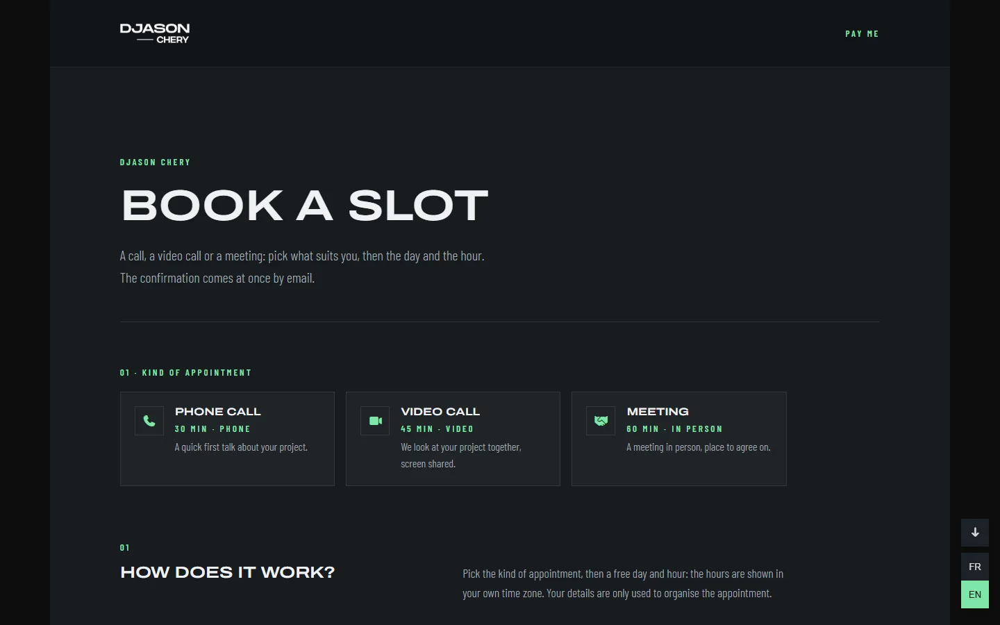</td>
    <td width="50%">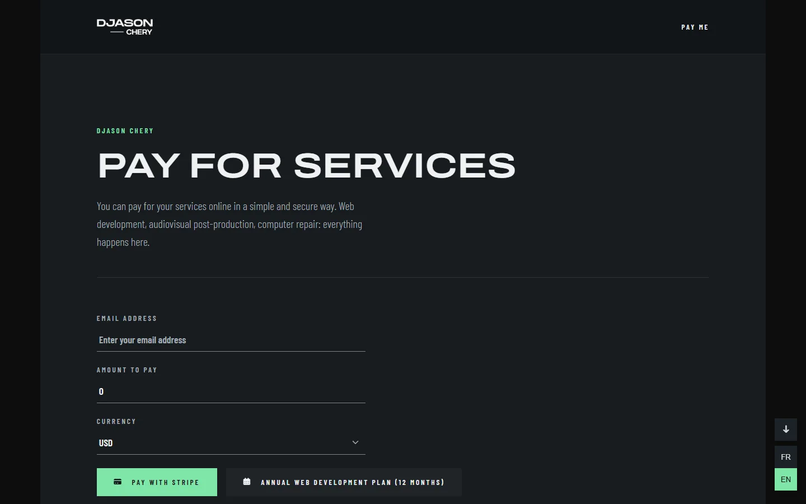</td>
  </tr>
  <tr>
    <th width="50%">Legal notice</th>
    <th width="50%">Français</th>
  </tr>
  <tr>
    <td width="50%">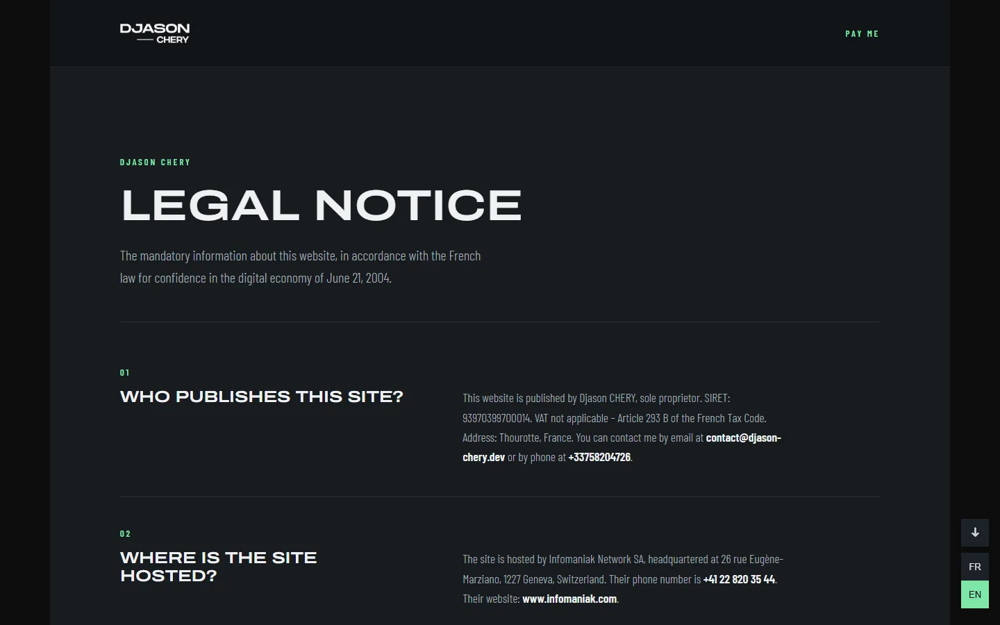</td>
    <td width="50%">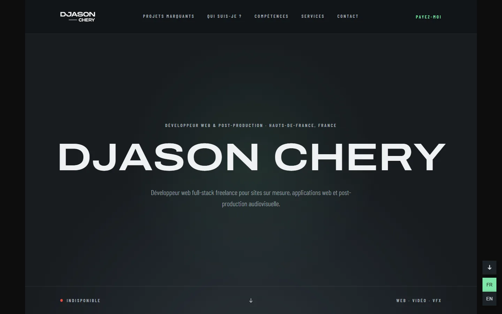</td>
  </tr>
</table>

<table>
  <tr>
    <th width="50%">Phone</th>
    <th width="50%">Menu</th>
  </tr>
  <tr>
    <td width="50%" align="center">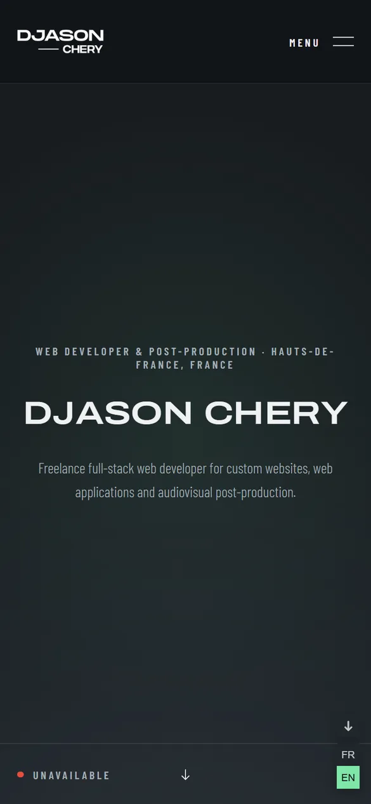</td>
    <td width="50%" align="center">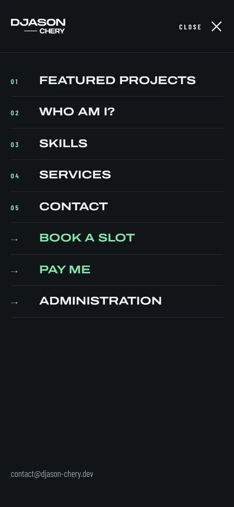</td>
  </tr>
</table>

## Stack

- [Nuxt 4](https://nuxt.com "Nuxt") (Vue 3.5, server-side rendering) and its **Nitro** server for the API, all in
  **TypeScript** (`npm run typecheck` at zero errors)
- [Pinia](https://pinia.vuejs.org "Pinia") for the stores (site settings, texts, admin lists, preferences)
- **MySQL** (`mysql2`), Docker and phpMyAdmin locally, Infomaniak's MySQL online; `dc_*` tables created on start
- [Stripe](https://stripe.com "Stripe") (Checkout, subscriptions, webhook), [Nodemailer](https://nodemailer.com "Nodemailer")
  for the e-mails, [jsPDF](https://github.com/parallax/jsPDF "jsPDF") for the PDFs
- WebRTC for the video room, [MediaPipe](https://ai.google.dev/edge/mediapipe "MediaPipe") for the backgrounds, loaded
  only when an effect is chosen
- Plain CSS with variables, Archivo and Barlow Condensed fonts hosted with the site, Font Awesome 7 cut down to the
  icons in use (`scripts/icons.mjs`)
- `@nuxtjs/sitemap` and `@nuxtjs/robots`, set like the DC Scaffold model

## Run it

Requires **Node.js 22.16+** (24 LTS recommended) and **Docker Desktop** (local MySQL database).

**Windows:** `start.bat`, then `I` (install, the first time) and `D`. The site opens on http://localhost:3000,
phpMyAdmin on http://localhost:8081.

**macOS / Linux:**

```bash
git clone https://github.com/Djason16/dc-portfolio.git
cd dc-portfolio/frontend
cp .env.example .env   # then fill in your values
docker compose --project-directory .. --env-file .env up -d   # MySQL + phpMyAdmin
npm install
npm run dev            # http://localhost:3000, API on /api
```

`frontend/.env.example` lists every variable (database, admin account, SMTP, Stripe, bank, translation, video relay).
To test without sending any e-mail, `MAIL_LOG_ONLY=true` writes them to the server log. Details:
[docs/en/02-configuration.md](docs/en/02-configuration.md "Configuration").

## Scripts and checks

Run in `frontend/`.

| Command | Role |
| --- | --- |
| `npm run dev` | Development site on http://localhost:3000 (cuts Font Awesome down and copies MediaPipe first) |
| `npm run typecheck` | TypeScript (`nuxt typecheck`): zero errors |
| `npm run build` | Production build in `.output/`, reads `.env.production` |
| `npm run build:qualif` | Staging build, reads `.env.preprod` (`start.bat` then `Q`) |
| `npm run start` | Runs the build (`node .output/server/index.mjs`) |
| `npm run db:backup` / `db:restore` | Backup and restore of the local database and its uploaded images (`start.bat` then `K` / `O`: local development only; the production database is backed up every Sunday by DC Sentinel, see [Deployment](docs/en/08-deployment.md "Deployment")) |

## Folders

```text
frontend/
├── pages/              one file per page: sets its SEO and shows its view
├── components/
│   ├── layout/         AppShell (loader, header, footer, cookie banner, language), Header, Footer
│   ├── ui/             reusable pieces: Button, Form, Image, Modal, Table, SectionLayout, Loader, Toast...
│   └── views/          content of each page (Index, Book, Room, PayMe, Admin, Documents, Legal...)
├── composables/        useAuth, useLang, useSeo, useRoomCall, useBookingAdmin, useProjects...
├── stores/             Pinia stores, their actions in stores/actions/
├── plugins/            languages (translations/ fr and en), live data, reveal animations
├── utils/              api.ts (API client), billing.ts, pdf.ts, scroll.ts, room/ (video room)...
├── data/               starting projects, services and skills
├── server/
│   ├── api/            [...path].ts: router of every controller
│   ├── controllers/    one *Controller.ts per resource = the API routes
│   ├── utils/          DC Scaffold base: Controller, RequestHelper, ResponseHelper, DatabaseHelper...
│   ├── helpers/        site helpers: DatabaseSchema, MailHelper, StripeHelper, BookingHelper, RoomHelper...
│   ├── middleware/     www redirect, security headers
│   ├── plugins/        table creation, staging, page compression
│   └── templates/      e-mails and Stripe result pages
├── scripts/            icons.mjs, mediapipe.mjs, qualif.mjs, db-backup.mjs, db-restore.mjs
└── public/             fonts, images, favicon, MediaPipe model
mysql/                  Docker image of the local database and init/example.sql (tables, no personal data)
scripts/                start.bat tools (backup, restore, staging)
docs/                   documentation (en, fr) and screenshots
```

More details: [docs/en/03-architecture.md](docs/en/03-architecture.md "Architecture").

## Site rules

- **TypeScript everywhere**: every file is `.ts`, every component `<script setup lang="ts">`.
- **Thin pages**: `pages/*.vue` shows its view from `components/views/` and calls `useSeo`.
- **No hard-coded text**: everything goes through the translations (French and English), some texts can be changed
  from the admin.
- **300 lines at most per file**, short comments in English.
- **Hover and pressed states** only with a mouse (`@media (hover: hover) and (pointer: fine)`); the link to the
  current page carries `aria-current="page"`, which alone gives the active style.
- **One light loader**, on opening and on every page change.
- **Accessibility**: down to 320 px wide and high, keyboard everywhere, visible mint focus, AA contrast, every link has
  a `title`, every image an `alt` and a `title`.
- **Security**: security headers on every response, rate limits (login, contact, booking), uploads checked by their
  content, tokens stored hashed, too long texts refused. Details: [docs/en/07-security.md](docs/en/07-security.md "Security").

## Deployment

The site and the API are a single Node.js app hosted at **Infomaniak** (HTTPS included): `npm run build`, then upload
`.output/`, `package.json`, `package-lock.json` and `.env.production`; start command `npm run start`, port `3000`. On
the first start, the site creates the missing tables and the admin account. Full steps:
[docs/en/08-deployment.md](docs/en/08-deployment.md "Deployment").

## Documentation

| Topic | English | Français |
| --- | --- | --- |
| Getting started | [01-getting-started.md](docs/en/01-getting-started.md "Getting started") | [01-demarrer.md](docs/fr/01-demarrer.md "Démarrer (français)") |
| Configuration | [02-configuration.md](docs/en/02-configuration.md "Configuration") | [02-configuration.md](docs/fr/02-configuration.md "Configuration (français)") |
| Architecture | [03-architecture.md](docs/en/03-architecture.md "Architecture") | [03-architecture.md](docs/fr/03-architecture.md "Architecture (français)") |
| The site | [04-site.md](docs/en/04-site.md "The site") | [04-le-site.md](docs/fr/04-le-site.md "Le site (français)") |
| The API | [05-api.md](docs/en/05-api.md "The API") | [05-l-api.md](docs/fr/05-l-api.md "L'API (français)") |
| Admin and documents | [06-admin-documents.md](docs/en/06-admin-documents.md "Admin and documents") | [06-documents-admin.md](docs/fr/06-documents-admin.md "L'admin et les documents (français)") |
| Security | [07-security.md](docs/en/07-security.md "Security") | [07-securite.md](docs/fr/07-securite.md "Sécurité (français)") |
| Deployment | [08-deployment.md](docs/en/08-deployment.md "Deployment") | [08-mise-en-ligne.md](docs/fr/08-mise-en-ligne.md "Mise en ligne (français)") |
| Troubleshooting | [09-troubleshooting.md](docs/en/09-troubleshooting.md "Troubleshooting") | [09-depannage.md](docs/fr/09-depannage.md "Dépannage (français)") |

## Contact

<p>
  <a href="https://djason-chery.dev" title="Djason CHERY's website"></a>
  <a href="mailto:contact@djason-chery.dev" title="Write to contact@djason-chery.dev"></a>
  <a href="https://www.linkedin.com/in/djason-chery-3b87702b4" title="LinkedIn profile"></a>
  <a href="https://www.malt.fr/profile/djasonchery" title="Malt profile"></a>
  <a href="https://wa.me/33758204726" title="Write on WhatsApp"></a>
  <a href="https://www.instagram.com/djasonchery" title="Instagram profile"></a>
</p>

## License

The code is shown so it can be read and evaluated, **all rights reserved**: no reuse without written permission, see
[LICENSE](LICENSE "License") (licence on request: [djason-chery.dev](https://djason-chery.dev "Djason CHERY's website")).
Versions published before 22 November 2026 were under the MIT license. The MediaPipe model and runtime of the video
room backgrounds (`frontend/public/mediapipe/`, `@mediapipe/tasks-vision`) are Apache 2.0, by Google.

## Credits

- Fonts: **Archivo** and **Barlow Condensed** (SIL Open Font License 1.1), through `@fontsource`.
- Icons: **Font Awesome Free 7** (icons CC BY 4.0, font SIL OFL 1.1, code MIT).
- Video room backgrounds: **MediaPipe** Image Segmenter and the `selfie_segmenter` model (Apache 2.0, Google).
- Admin auto-translation: **MyMemory**.
- Design and development: [Djason CHERY](https://djason-chery.dev "Djason CHERY's website"), with
  [DC Scaffold](https://tools.djason-chery.dev/en/scaffold/ "Discover DC Scaffold").
